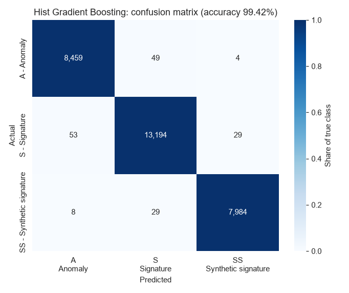
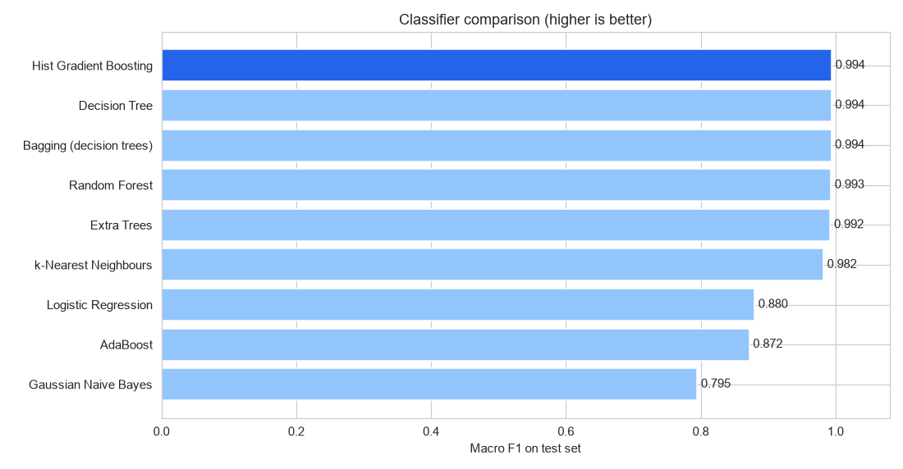
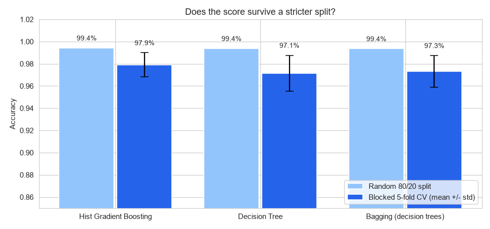
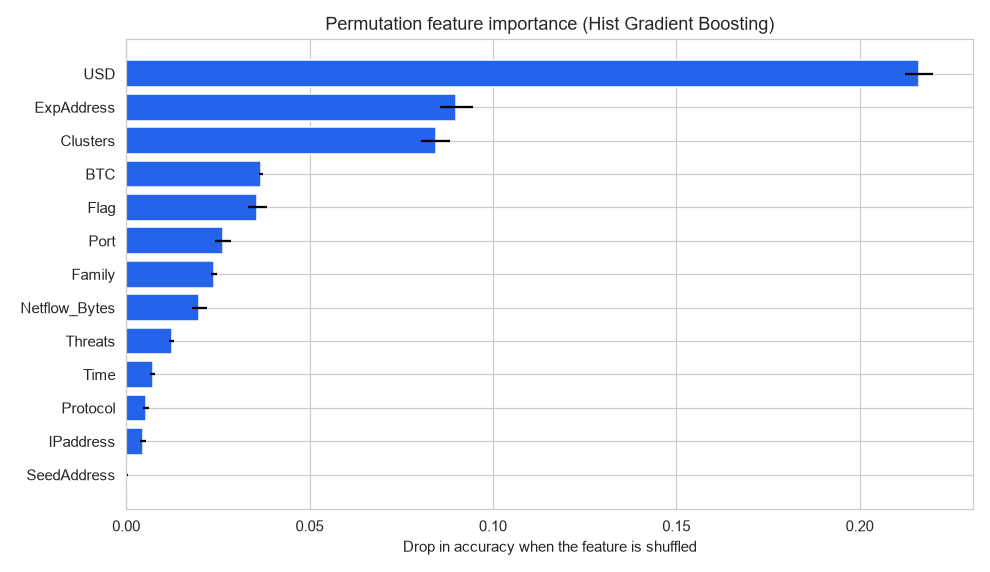
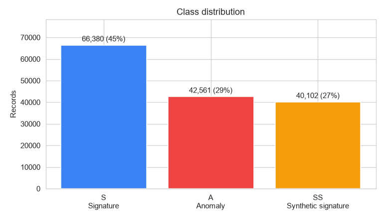
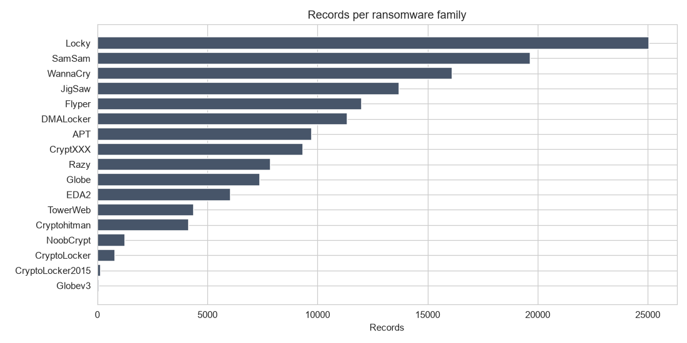
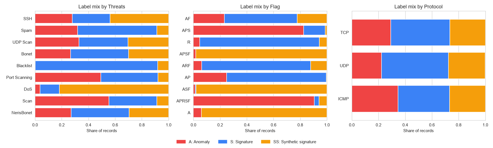
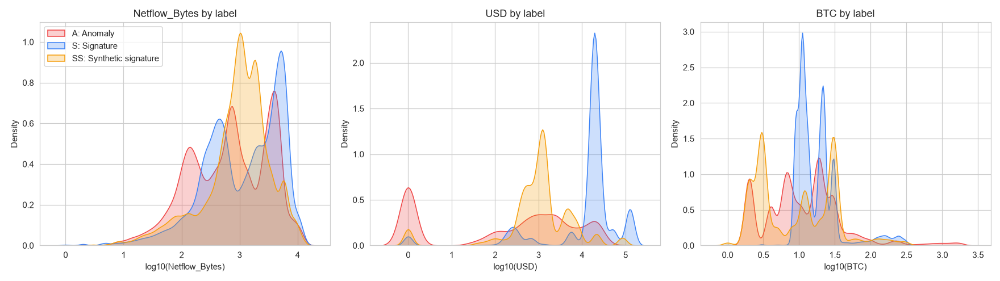

# Ransomware & Network Intrusion Detection

A machine learning pipeline that classifies network-traffic records as **anomalies (zero-day attacks)**, **known attack signatures** or **synthetic signatures**, using the UGRansome ransomware dataset. Nine classifiers are compared, the best model is stress-tested with a stricter blocked cross-validation, and permutation importance shows what drives its decisions.



## Results

The best model is **Histogram-based Gradient Boosting**:

| Evaluation | Accuracy |
|------------|---------:|
| Random 80/20 test split (29,809 records) | **99.42%** |
| Blocked 5-fold cross-validation (whole 1,000-row chunks held out) | **97.9% ± 1.1%** |

Per-class results on the test set:

| Class | Precision | Recall | F1 |
|-------|----------:|-------:|---:|
| A: Anomaly | 0.993 | 0.994 | 0.993 |
| S: Signature | 0.994 | 0.994 | 0.994 |
| SS: Synthetic signature | 0.996 | 0.995 | 0.996 |

### Classifier comparison

| Model | Accuracy | Balanced accuracy | Macro F1 | Train time |
|-------|---------:|------------------:|---------:|-----------:|
| **Hist Gradient Boosting** | **0.9942** | **0.9943** | **0.9943** | 12.5 s |
| Decision Tree | 0.9938 | 0.9937 | 0.9938 | 2.0 s |
| Bagging (decision trees) | 0.9935 | 0.9935 | 0.9936 | 13.3 s |
| Random Forest | 0.9932 | 0.9932 | 0.9932 | 16.4 s |
| Extra Trees | 0.9922 | 0.9923 | 0.9923 | 15.6 s |
| k-Nearest Neighbours | 0.9819 | 0.9820 | 0.9820 | 1.1 s |
| Logistic Regression | 0.8830 | 0.8813 | 0.8799 | 11.3 s |
| AdaBoost | 0.8799 | 0.8661 | 0.8720 | 32.3 s |
| Gaussian Naive Bayes | 0.7957 | 0.8143 | 0.7949 | 1.6 s |



Tree-based models clearly win. The decision boundaries depend on interactions between categorical features (TCP flags, threat type, cluster) and payment amounts, which linear models and Naive Bayes can't capture.

## Does the 99% hold up?

UGRansome records are generated in sequence, so neighbouring rows are often near-identical. With a random split, a test record's near-twin is usually in the training set, which can inflate the score. To check this, the data was cut into **contiguous 1,000-row blocks**, and whole blocks were held out with `GroupKFold`:



Accuracy drops by about 1.5 points, to 97.9%, with the weakest fold at 96.3%. The model genuinely generalises to unseen stretches of traffic, but **97–98% is the more honest estimate** for new data.

## What drives the predictions?



Permutation importance measures how much accuracy drops when a feature is shuffled. **USD ransom amount**, **exploit address**, **cluster** and **BTC amount** matter most, followed by the TCP **flags**. The strong role of payment amounts reflects how UGRansome was built. In a real deployment, you'd want to validate this on independent traffic captures.

## Exploratory analysis

<p>
  
  
</p>



Some flags are near-perfect indicators: `APSF` and `ASF` are almost always synthetic signatures, while `APRSF` and `APS` are mostly anomalies. Others, such as `AF`, are mixed, so the model has to combine several features.



## Pipeline

1. **Split first:** a stratified 80/20 train/test split before any preprocessing.
2. **Encode inside a pipeline:** `OrdinalEncoder` for tree models, and `OneHotEncoder` + `StandardScaler` for linear and distance-based models. These are fitted on training data only, so nothing leaks from the test set.
3. **No outlier removal:** in intrusion data, extreme values such as huge transfers or large ransom payments are often the signal itself, and tree models handle them well.
4. **Compare 9 classifiers**, then evaluate the best with a classification report and confusion matrix.
5. **Stress test** with blocked cross-validation.
6. **Explain** the model with permutation importance.
7. **Save** the whole pipeline (encoder + model) as a single `joblib` file.

## Getting started

```bash
git clone https://github.com/arslanahmedbhutto/ransomware-intrusion-detection.git
cd ransomware-intrusion-detection
pip install -r requirements.txt
```

**Use the trained model** (included, 0.6 MB):

```bash
python predict.py                      # classifies two example records
python predict.py path/to/records.csv  # classifies a CSV and saves *_predictions.csv
```

```
  Family Threats Flag predicted     predicted_label  confidence
WannaCry   Bonet    A        SS Synthetic signature      0.9996
   Locky    Scan  APS         S           Signature      0.6247
```

**Reproduce the analysis:** download the dataset (see [data/README.md](data/README.md)), then run `intrusion_detection.ipynb`. It takes about 5 minutes on a laptop CPU.

## Project structure

```
ransomware-intrusion-detection/
├── intrusion_detection.ipynb   # EDA, model comparison, blocked CV, feature importance
├── predict.py                  # Command-line predictions with the saved model
├── model/
│   ├── intrusion_model.joblib  # Trained pipeline (encoder + gradient boosting)
│   ├── model_comparison.csv    # Scores for all 9 classifiers
│   └── results.json            # Final metrics
├── data/README.md              # Dataset download and column descriptions
└── screenshots/
```

## Tech stack

Python · scikit-learn · pandas · NumPy · Matplotlib · Seaborn · joblib

## Acknowledgements

The dataset is UGRansome by Nkongolo, van Deventer & Kasongo (2021), *UGRansome1819: A novel dataset for anomaly detection and zero-day threats*, Information 12(10), 405.
